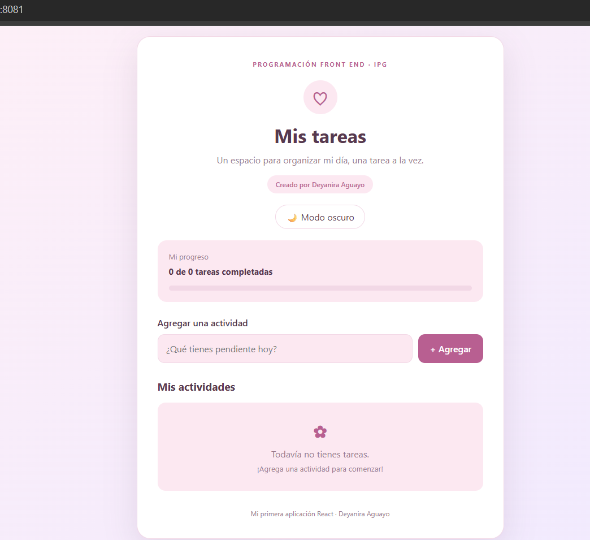
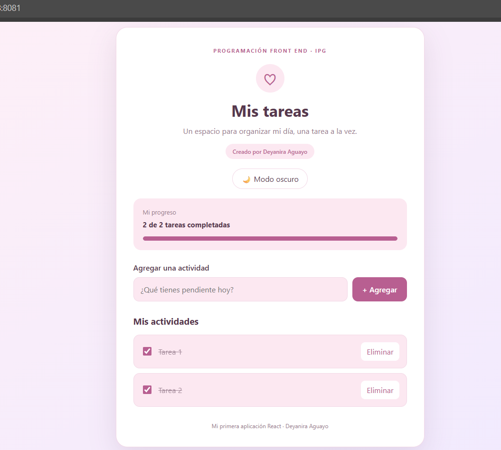
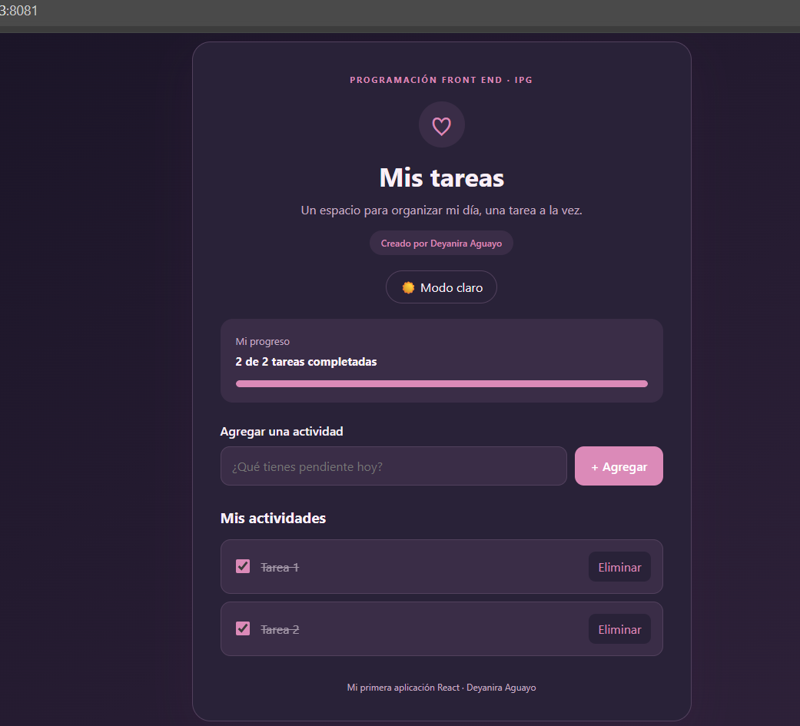

# Mi Primera Aplicación en React

**Estudiante:** Deyanira Aguayo  
**Institución:** Instituto Profesional IPG  
**Asignatura:** Programación Front End  
**Unidad:** 2  
**Evaluación:** Semana 4  

## Descripción

Aplicación web desarrollada con React y Vite para
gestionar una lista de tareas personales.

Permite agregar, completar y eliminar actividades,
visualizar el progreso y cambiar entre modo claro
y oscuro.

## Tecnologías utilizadas

- React 19
- Vite 8
- JavaScript y JSX
- HTML5 y CSS3
- Node.js y npm
- Git y GitHub
- Nginx

## Componentes principales

- **App.jsx:** administra los estados y la lógica.
- **Header.jsx:** presenta el encabezado.
- **TaskForm.jsx:** permite ingresar tareas.
- **TaskList.jsx:** muestra la lista de actividades.
- **TaskItem.jsx:** representa cada tarea individual.

## Uso de useState

Se utiliza el hook useState para administrar:

1. La lista de tareas.
2. El texto ingresado en el formulario.
3. El tema claro y oscuro.

Cada cambio de estado actualiza la interfaz
automáticamente, sin recargar la página.

## Instalación

Requisitos: Node.js compatible con Vite 8,
npm y Git.

Clonar el repositorio:

```bash
git clone https://github.com/deyaniraaguayo-c/mi-primera-app-react.git
cd mi-primera-app-react
```

Instalar dependencias:

```bash
npm install
```

Iniciar la aplicación:

```bash
npm run dev
```

## Compilación

Validar el código:

```bash
npm run lint
```

Compilar para producción:

```bash
npm run build
```

## Funcionamiento

1. Escribir una actividad en el formulario.
2. Presionar Agregar.
3. Marcar las tareas completadas.
4. Eliminar actividades cuando sea necesario.
5. Consultar la barra de progreso.
6. Cambiar entre modo claro y oscuro.

Las tareas se almacenan temporalmente
en el estado de React.

## Diseño

La interfaz utiliza colores rosados y lilas,
bordes redondeados, una tarjeta central y
estilos adaptables a dispositivos móviles.

## Evidencias

Las capturas de pantalla se encuentran
en la carpeta docs/capturas/.

## Publicación

La aplicación está disponible en la red local:

http://10.0.10.183:8081

## Conclusión

Este proyecto permitió aplicar los fundamentos
de React mediante componentes reutilizables,
manejo de estados, eventos y estilos CSS.

También permitió comprender la importancia
de GitHub para documentar y organizar un
proyecto de programación Front End.

## Autora

Deyanira Aguayo

Repositorio:
https://github.com/deyaniraaguayo-c/mi-primera-app-react

## Capturas de pantalla

### Pantalla principal



### Tareas agregadas y completadas



### Modo oscuro



